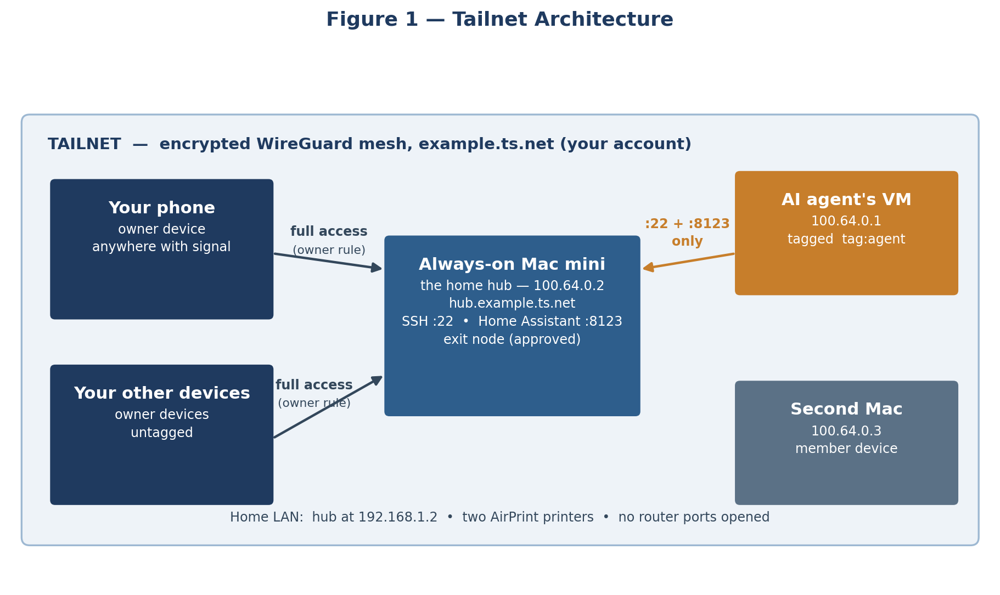
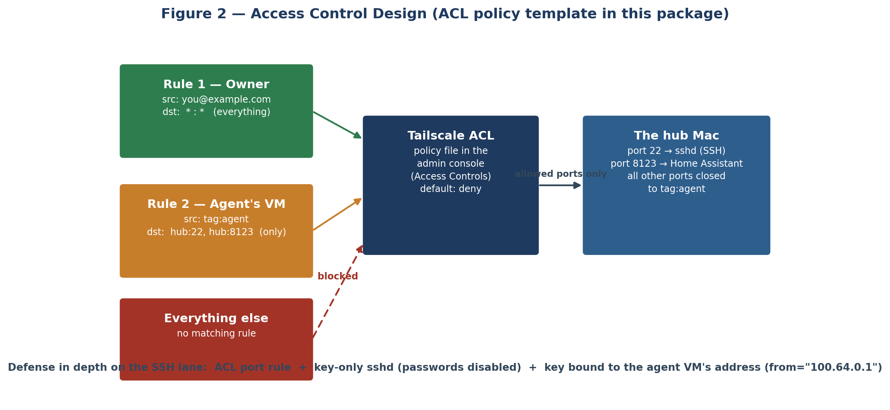
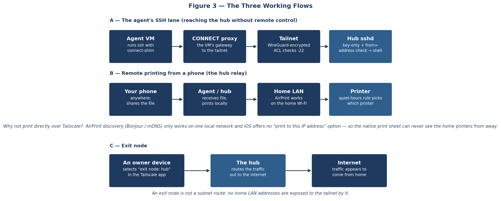

# A Least-Privilege Tailscale Lane for a Home AI Agent

*A design for letting an AI agent reach exactly two services on one always-on home Mac — a shell and Home Assistant — and nothing else, while the owner's own devices keep full access from anywhere. Generalized from a working home deployment (built and verified live with Muse as the agent), so someone else can build the same thing.*

**Files in this package**

- `README.md` — this document: the design, the reasoning, and the operations notes
- `tailscale-acl-template.json` — the access policy (two rules), with example addresses to replace
- `100-tailscale-lane.conf` — the sshd drop-in that makes the hub's SSH key-only
- `connect-shim.py` — an SSH ProxyCommand shim, needed only if your agent can reach the network solely through an HTTP CONNECT proxy
- `diagram-1-architecture.png`, `diagram-2-access-control.png`, `diagram-3-flows.png` — the three figures referenced below

**What you end up with**

A private Tailscale network ("tailnet") where your phone and personal devices can reach the house from anywhere; an always-on Mac at home acts as the hub and as an approved exit node; and your AI agent's machine — tagged, and fenced in by the access policy — can open exactly two doors on that one Mac: SSH (port 22) and Home Assistant (port 8123). No ports are opened on the home router at any point.

---

## 1. What This Design Is For

Three working goals:

1. **Reach the house from anywhere.** Your own devices can reach the hub Mac from any network, for anything you yourself are allowed to do.
2. **Give the agent narrow, auditable lanes into the house.** The agent needs to check and operate specific services on the hub — a shell and Home Assistant — *without* a screen remote-control session, and *without* broad access to the rest of the home network. These lanes work when nobody is home.
3. **Print at home while away.** This turned out not to be a Tailscale feature at all; Section 7 records the finding and the workflow that replaced it.

## 2. Design Principles

- **Least privilege for the agent, full access for the owner.** Your devices keep unrestricted access. The agent's machine gets exactly two ports on exactly one machine — nothing else, nowhere else.
- **Deny by default.** The access policy is an allow-list. Anything not named in it is blocked, including any future device or port.
- **Defense in depth on the SSH lane.** Three independent controls guard the shell: the Tailscale ACL port rule, an SSH server that accepts keys only (passwords disabled), and a key that is only valid when it arrives from the agent machine's own tailnet address. Any one of them failing still leaves the other two.
- **No holes in the router.** Nothing in this design opens a port on the home router or exposes a home LAN address to the internet. All connections are outbound-initiated and encrypted by WireGuard.
- **Every change is reversible, and the undo is written down** (Section 8).
- **Deliberate non-features.** Considered and rejected, on purpose: subnet routing (would expose the whole home LAN to the tailnet), Tailscale's built-in SSH (would bypass the Mac's own key controls), and direct phone-to-printer printing over Tailscale (not technically possible — Section 7).

## 3. Architecture



**Figure 1 — Tailnet Architecture.** Every device runs Tailscale and gets a stable private address in the 100.x range. Connections between devices are encrypted WireGuard tunnels, direct whenever a direct path exists; Tailscale's servers coordinate introductions and hold the access policy, and when no direct path is possible they relay the traffic through DERP servers, still end-to-end encrypted — they never see its contents.

The example addresses in this package (`100.64.0.1`, `100.64.0.2`, `100.64.0.3`) are placeholders — substitute your own from the admin console's Machines page.

| Device | Example Address | Role |
|---|---|---|
| Always-on Mac mini at home | 100.64.0.2 (`hub`) | The hub: runs Home Assistant; approved exit node; the only machine the agent can reach |
| The agent's machine (a VM) | 100.64.0.1, tagged `tag:agent` | Client-only in this example: outbound connections only, via a proxy |
| A second Mac | 100.64.0.3 | Member device (owner's) |
| Phone and other personal devices | various | Owner devices, untagged, unrestricted |

The hub should be a machine that is already always on — in the original deployment it also hosts the house's Home Assistant, both home printers (mapped locally), and other always-on duties. On its home LAN it keeps a reserved address; the tailnet address is the door that works from anywhere.

## 4. Access Control Design



**Figure 2 — Access Control Design.** The policy lives in the Tailscale admin console (Access Controls) as a single policy file. It contains exactly two rules.

| # | Who (Source) | May Reach (Destination) | Meaning |
|---|---|---|---|
| 1 | The owner (your account — your untagged devices) | `*:*` — any device, any port | Unrestricted, exactly as in Tailscale's default policy |
| 2 | The agent's machine (`tag:agent`) | `hub:22`, `hub:8123` | Only the hub, and on it only SSH (22) and Home Assistant (8123) |

Everything else is denied by default — including the agent reaching any other machine, any printer, or any other port on the hub itself.

Two supporting definitions in the same file: `tagOwners` (only tailnet admins can apply the agent tag) and `hosts` (friendly names for the two fixed addresses, so the rules read as names, not numbers). The full template is `tailscale-acl-template.json` in this package.

Grow it one port at a time. In the original deployment, the policy shipped first with SSH only; Home Assistant's port was added later, as a separate deliberate change, when the owner decided the agent should have it. Each addition is one line — and one decision.

## 5. The SSH Lane

Purpose: the agent can run commands and checks on the hub — reading service health, verifying configurations, pulling status — without a remote-control session, without disturbing the machine, and without the owner being present.



**Figure 3, Panel A — The SSH Lane.** If the agent's machine reaches the network only through an HTTP CONNECT proxy (common for sandboxed cloud VMs), SSH needs a ProxyCommand that opens the tunnel through the proxy first — that is what `connect-shim.py` does. If your agent connects directly, skip the shim; plain `ssh` over the tailnet is the whole recipe.

The lane has four components:

1. **On the agent's machine — the key and (if needed) the shim.** A standard ed25519 keypair; the public half goes on the hub (component 4). With a proxy in the path, configure SSH with `ProxyCommand "python3 connect-shim.py %h %p"`.
2. **In the tailnet — the ACL rule** (Section 4, Rule 2). Port 22 on the hub is reachable from `tag:agent` and from nobody else except the owner.
3. **On the hub — Remote Login, deliberately narrowed.** Turn macOS Remote Login (SSH) ON — and narrow it the same day with a drop-in at `/etc/ssh/sshd_config.d/100-tailscale-lane.conf` that disables every password path and allows keys only. The file is in this package; its whole contents are:

   ```
   PubkeyAuthentication yes
   PasswordAuthentication no
   KbdInteractiveAuthentication no
   ChallengeResponseAuthentication no
   # No forwarding or tunneling: the key opens a shell on this machine only.
   AllowTcpForwarding no
   PermitTunnel no
   AllowAgentForwarding no
   X11Forwarding no
   ```

4. **On the hub — the bound authorized key.** The agent's public key goes into `~/.ssh/authorized_keys` with an address binding:

   ```
   restrict,from="100.64.0.1" ssh-ed25519 <agent's public key> agent
   ```

   The key is accepted *only* when the connection arrives from the agent machine's tailnet address. The same key copied anywhere else is useless on this machine. (Use your agent's real tailnet address, not the example.) The `restrict` option also disables port forwarding, agent forwarding, X11 forwarding, and PTY allocation for this key at the key layer as well, so the key can do nothing beyond opening the shell even if a server setting is ever loosened.

**Why not Tailscale's built-in SSH?** Tailscale offers its own SSH feature that replaces the Mac's SSH server. Leave it OFF: it would bypass the Mac-side controls above (key-only settings and the address binding) and move trust into a separate system. One door, guarded the Mac's own way.

**Verify it the day you build it:** from the agent's machine, connect and confirm the shell answers with the hub's name and OS — and then, just as important, confirm a *wrong* door is closed (for example, that the agent cannot reach some other port or machine the policy doesn't name). A lane you haven't tested in both directions is a hope, not a control.

## 6. The Home Assistant Lane

If the hub runs Home Assistant (in the original deployment, Home Assistant Core as a LaunchAgent, configuration in `~/.homeassistant`), the second ACL destination — `hub:8123` — lets the agent open Home Assistant's web address directly over the tailnet, with no remote-control session and no SSH tunnel in between.

What it is for: the agent can read house state (temperatures, device health, automations) programmatically and build checks on top of it — trend history and escalating alerts, which the typical smart-home app does not offer to an outside program.

One honest boundary, worth designing around: **reaching Home Assistant is not the same as being logged in to it.** The port gets the agent to the front door; Home Assistant's own login still applies before anything is shown. Treat credential setup for Home Assistant as its own step, and don't let a successful port test be reported as "integrated."

## 7. Remote Printing — a Finding, and the Workflow That Replaced It

**Question:** can you print to the home printers from a phone, from anywhere, using Tailscale?

**Answer: not natively, and the reason is structural.** The iPhone's print sheet finds printers through AirPrint discovery (Bonjour/mDNS), which only works on the local Wi-Fi network it is currently on — VPNs, including Tailscale, do not carry it — and iOS offers no "print to this IP address" option. A Mac or laptop *could* print house-to-house by adding a printer by its LAN address; the phone cannot.

**The workflow instead** (Figure 3, Panel B) — the hub relay:

1. The owner sends or shares the file to the agent, from wherever they are.
2. The agent prints it on the hub, which already has the home printers mapped — the hub is *on* the home Wi-Fi, so AirPrint works normally there.
3. A house rule picks the printer (in the original: the office printer before about 9–10 PM, the bedroom printer after — so a late print doesn't wake anyone in the wrong room).

No subnet router is needed for printing, and setting one up does not fix the phone problem — discovery is the blocker, not routing.

## 8. The Exit Node, and the Kill Switches

**Exit node** (Figure 3, Panel C): approve the hub as an exit node in the console (Machines → hub → Edit route settings → "Use as exit node"). Any owner device can then select it in its Tailscale app, and its internet traffic travels through the tailnet to the hub and out from home — appearing to come from the home connection. Useful on untrusted Wi-Fi. An exit node is *not* a subnet route: it exposes no home LAN addresses, and no subnet routes need advertising. In this design the agent's machine cannot use the exit node at all.

**Ways to cut access, fastest first:**

| To Stop… | Do This | Effect |
|---|---|---|
| The agent's SSH, instantly | On the hub: System Settings → General → Sharing → turn Remote Login OFF | The lane dies immediately; nothing else on the hub changes |
| The agent's SSH, permanently | Delete the agent's line from `~/.ssh/authorized_keys` — this is the required step, and the only one that revokes the key. Removing the drop-in file is optional cleanup, never a substitute: deleting the drop-in alone leaves the key fully valid and restores the default password sign-in paths the drop-in had disabled | The key can never authenticate again |
| The agent's access entirely | In the admin console: remove Rule 2 from the policy, or delete the agent's device | The agent can reach nothing on the tailnet |
| A lost owner device | In the admin console: delete that device | Its access ends everywhere at once |
| Everything | Delete devices in the console; quit and remove Tailscale from the hub | Full teardown; also remove the VPN configuration in System Settings |

## 9. Operations Notes — Lessons Already Paid For

- **If you drive the admin console through any remote-control channel, beware merged pastes.** The console's policy editor is a code editor; under synthetic input, Select All can silently fail, and a "replace-all" paste then *merges at the cursor* instead of replacing — producing a corrupted policy that still looks plausible. Defenses: always use the console's **Preview changes** before saving and confirm the diff is exactly the lines you intended (in the original deployment the correct diff was a single line); if a paste looks merged, **Discard — never Save** — and start over; after saving, reload the page and read the policy back.
- **Verify the boring prerequisite first.** In the original build, the SSH lane "failed" for hours because macOS Remote Login was off — a setup script's attempt to enable it had failed silently while reporting success. When a lane is silent, read the hub's Sharing settings with your own eyes before debugging the network.
- **The console may be reachable from fewer places than you expect.** Tailscale's site blocked the agent's cloud browser outright (connection reset). Console work happened from a browser on the hub itself, signed in to the owner's account. Plan for console changes to be hub-side work.
- **Stage policy text, don't retype it.** Keep the policy file under version control outside the console (the template in this package is the source of record in the original deployment), and paste from the file. JSON typed by hand — by a human or an agent — is how quiet syntax errors get in.
- **Sequence changes one door at a time.** Ship the SSH lane, verify it in both directions, live with it, then add the next port as its own change with its own verification. Two of this design's three principles (deny by default, least privilege) are only real if each opening is deliberate.

## 10. The Short Version, for Explaining It to Someone

"Tailscale gives my devices a private encrypted network that works from anywhere, with no ports opened on my router. My own phone and computers can reach the house freely. My AI agent's machine is on that network too, but it's tagged and fenced: the access policy lets it touch exactly one machine — the always-on Mac at home — on exactly two ports, SSH and Home Assistant. The SSH door is key-only, and the key only works from the agent's own address. If I ever want the agent out, I can kill it three different ways, the fastest being one switch on the Mac. The one thing it can't do is print from my phone — AirPrint can't cross a VPN — so the agent relays print jobs through the home Mac instead."

---

*Generalized from a live home deployment. Example addresses (`100.64.0.x`, `you@example.com`, `example.ts.net`) are placeholders — substitute your own. No real addresses, names, or credentials from the original deployment appear in this package.*
